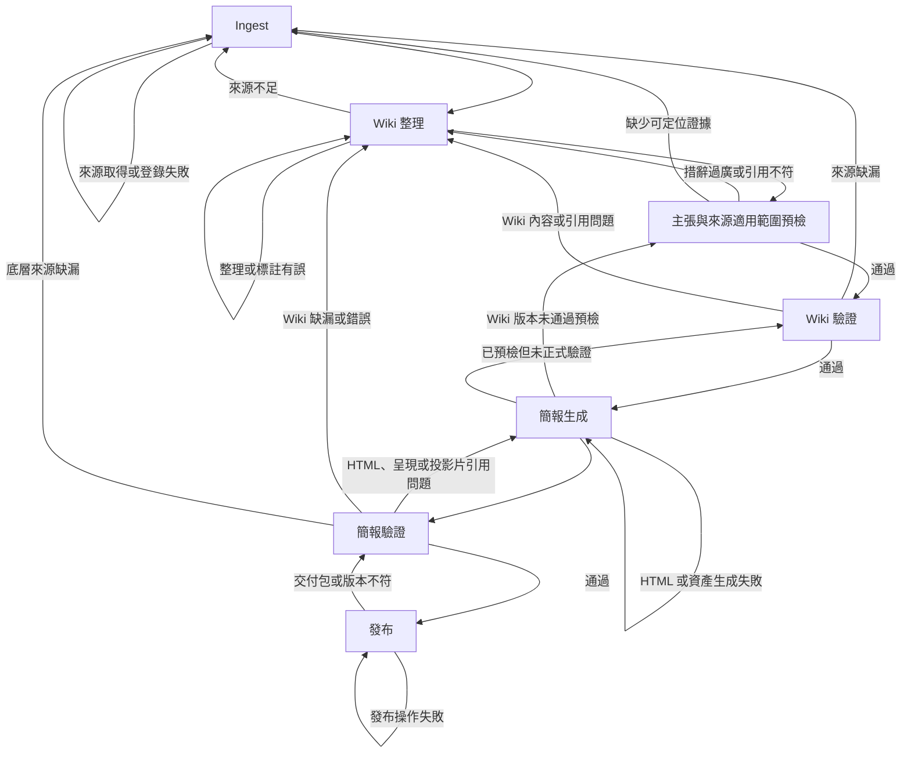

# 工作流程

目前這份文件是執行規劃。實際操作與觀察結果在開始執行後同步寫入 `logs/`。

## Graph

## 各節點完成條件與回退

| 節點 | 完成條件 | 失敗時去向 |
| --- | --- | --- |
| Ingest | 已讀取至少 5 篇不同資料。每篇有來源 ID、索引條目及可定位的原件或摘錄。 | 留在 Ingest，補齊缺項或更換無法取得的來源。 |
| Wiki 整理 | 依七類主題整理，標明官方資訊、一般原理及教學示範，主張可追溯。 | 來源不足回 Ingest。整理、分類或標註有誤則在 Wiki 整理修正。 |
| 主張與來源適用範圍預檢 | 逐項將主張對照來源 ID 及定位。確認來源支持整個句子，且主張的語氣、時間、平台、介面和條件皆在證據適用範圍內。記錄輸入版本、核對結果及對應證據，全部通過後才進入 Wiki 驗證。 | 來源足夠但措辭過廣、引用不符或缺少限定，回 Wiki 整理。缺少可定位證據，回 Ingest。 |
| Wiki 驗證 | 依來源逐項核對主張、連結、適用範圍、平台歸屬與示範標記。記下通過版本。 | 缺少支援資料或原始證據回 Ingest。已有來源但解讀、引用或分類有誤回 Wiki 整理。 |
| 簡報生成 | 固定已驗證 Wiki 版本，產出 HTML 及資產，標明各知識主張對應的 Wiki 段落。 | HTML 或資產生成失敗留在簡報生成。Wiki 版本未通過預檢則回預檢。已預檢但未正式驗證則回 Wiki 驗證。 |
| 簡報驗證 | 對照指定 Wiki 版本核對主張及示範。實際在瀏覽器測試入口檔、導覽、資產、文字可讀性及畫面溢出。 | 呈現、轉述或投影片引用出錯回簡報生成。Wiki 缺漏或有誤回 Wiki 整理。缺少底層來源回 Ingest。 |
| 發布 | 交付 HTML、資產、Wiki 版本參照及紀錄，並從交付位置確認入口檔與資產可用。 | 交付包或版本不符回簡報驗證。交付位置或操作失敗留在發布節點確認原因後重試。 |

回退後依正向順序重跑受影響節點。上游內容更動時，受影響的下游驗證視為待重跑。存在未通過或未確認的必要檢查時，暫停發布並記錄阻塞原因。

## 主張與來源適用範圍預檢

1. 記錄 Wiki 與來源卡的輸入版本。逐項列出主張位置、來源 ID、證據位置和檢查結果。複合句拆成可個別判定的子主張。
2. 確認引文支持完整主張。特定教材的學習目標、練習或案例應保留出處及案例範圍。寫成通則或普遍採用的做法時，需要能支持該範圍的證據。
3. 核對平台名稱、發表時間、產品介面、地區及條件。歷史工程案例保留年份和產品範圍。自製示範標明假設及虛構內容。
4. 已有足夠證據但主張越界時，回 Wiki 整理收窄說法或調整引用。證據缺漏時，回 Ingest。修正後新增預檢嘗試，記錄前次 ID 並重跑受影響項目，再進入正式 Wiki 驗證。

## 每次執行與重試紀錄

每輪執行在 `logs/` 建立一份 Markdown 紀錄，以日期和執行 ID 命名。每次操作或檢查追加一筆，重試沿用同一輪執行 ID 並使用新的嘗試序號。原始失敗紀錄保留。

| 欄位 | 記錄內容 |
| --- | --- |
| 識別 | 執行 ID、紀錄 ID、節點、嘗試序號、帶時區的時間 |
| 輸入與操作 | 輸入路徑及版本、實際步驟或命令、輸出位置 |
| 檢查與證據 | 預期條件、實際觀察、狀態（通過／失敗／未執行／未確認）、證據路徑或定位 |
| 回退與重試 | 前次紀錄 ID、失敗原因、回退節點、修正內容、應重跑的檢查 |

當錯誤暴露流程缺口（例如通過 Wiki 驗證後才發現平台說法缺少來源定位），在當輪紀錄追加流程調整，連回失敗紀錄，寫下舊規則、調整原因、新規則及生效時間。同步更新本文件，依新規則實際重跑相關檢查，再追加結果和證據。若根因仍待確認，記下觀察及待查項目。
